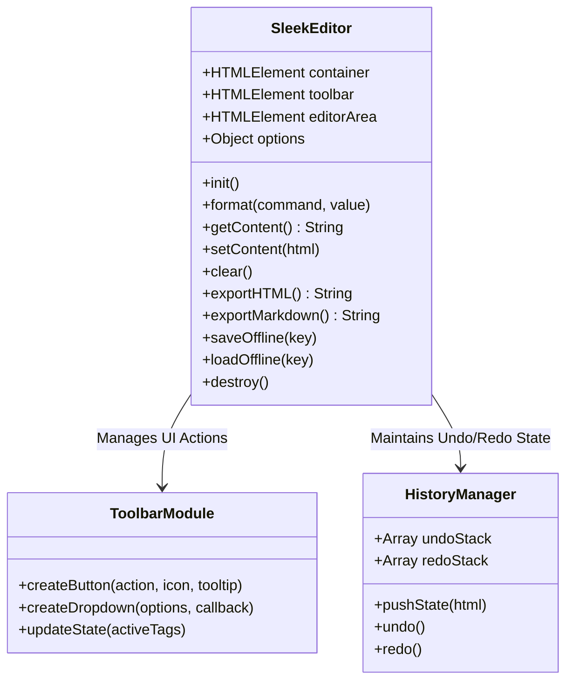

<div align="center">
  <h1>sleekeditor</h1>
  <p>Zero-dependency, offline-first WYSIWYG rich-text editor component and modular OOP JavaScript API.</p>

  <p>
    <a href="https://github.com/itsgoharrehman/sleekeditor/releases"></a>
    <a href="LICENSE"></a>
    
    
    <a href="https://github.com/itsgoharrehman/sleekeditor/stargazers"></a>
    <a href="https://github.com/itsgoharrehman/sleekeditor/issues"></a>
  </p>
</div>

---

## Overview

sleekeditor is a standalone, lightweight, zero-dependency WYSIWYG rich-text editor component built on standard web primitives and modern JavaScript (ES6+). Engineered with a clean Object-Oriented Programming (OOP) Class API, it provides full control over rich text formatting, clean HTML generation, keyboard shortcut handling, and offline-first browser persistence without bulky third-party dependencies or virtual DOM frameworks.

The editor is fully self-contained across two core distribution assets: `editor.js` and `editor.css`.

## Architecture and Component Model



## Core Capabilities

### 1. Strict Zero External Runtime Dependencies
* Implemented in pure Vanilla JavaScript with zero runtime libraries (no React, no Vue, no jQuery, no heavyweight bundlers required).
* Bundles into two minimal assets with sub-millisecond initialization time.

### 2. Comprehensive Formatting Controls
* **Typography**: Headings (H1–H6), paragraphs, bold, italic, underline, strikethrough, superscript, subscript.
* **Lists & Quotes**: Ordered lists, unordered lists, nested task lists, blockquotes.
* **Media & Links**: Hyperlink modals with target controls, inline image embeds, clean code blocks with syntax styling.
* **Alignment & Tables**: Left, center, right, justify alignments, and dynamic table insertion.

### 3. Offline-First Storage & Undo/Redo Engine
* Built-in `HistoryManager` providing granular undo/redo stacks (`Ctrl+Z` / `Ctrl+Y`).
* Automatic local storage autosave and crash recovery via `saveOffline()` and `loadOffline()`.

## Prerequisites & Browser Support

* Compatible with all modern evergreen browsers: Chrome 60+, Firefox 55+, Safari 12+, Edge 79+.
* Standard HTML5 `contenteditable` specification compliant.

## Quickstart & Integration

### 1. Include Assets

Link the stylesheet and script directly in your HTML:

```html
<link rel="stylesheet" href="editor.css">
<script src="editor.js"></script>
```

### 2. Mount Container

```html
<div id="editor-container"></div>
```

### 3. Initialize Editor

```javascript
const editor = new SleekEditor('#editor-container', {
    placeholder: 'Start writing your content here...',
    autosaveKey: 'draft_post_01',
    toolbar: [
        'bold', 'italic', 'underline', 'strikethrough', '|',
        'heading', 'quote', 'code', '|',
        'orderedList', 'unorderedList', '|',
        'link', 'image', 'table', '|',
        'undo', 'redo'
    ]
});

// Retrieve sanitized HTML content
const html = editor.getContent();
```

## API Reference

### Methods

| Method | Parameters | Return Type | Description |
| :--- | :--- | :--- | :--- |
| `init()` | None | `void` | Renders the toolbar and editor DOM elements. |
| `getContent()` | None | `String` | Returns the sanitized HTML content from the editor. |
| `setContent(html)` | `String` | `void` | Loads HTML string into the editor area. |
| `clear()` | None | `void` | Clears all content from the editor area. |
| `format(cmd, val)` | `String, String?` | `void` | Executes a formatting command (`bold`, `italic`, etc.). |
| `undo()` | None | `void` | Reverts editor to previous history state. |
| `redo()` | None | `void` | Restores next history state. |
| `saveOffline(key)` | `String` | `void` | Serializes current content into browser `localStorage`. |
| `loadOffline(key)` | `String` | `String?` | Retrieves cached draft from `localStorage`. |
| `destroy()` | None | `void` | Removes event listeners and unmounts DOM nodes. |

### Keyboard Shortcuts

| Shortcut | Action |
| :--- | :--- |
| `Ctrl + B` (`Cmd + B`) | Toggle Bold |
| `Ctrl + I` (`Cmd + I`) | Toggle Italic |
| `Ctrl + U` (`Cmd + U`) | Toggle Underline |
| `Ctrl + Z` (`Cmd + Z`) | Undo |
| `Ctrl + Y` (`Cmd + Shift + Z`) | Redo |
| `Ctrl + K` (`Cmd + K`) | Open Link Dialog |
| `Tab` | Indent / Insert Space |

## Security Considerations

* **DOM-based XSS Prevention**: When retrieving or setting content, output strings are passed through clean DOM sanitizers to strip malicious `<script>` tags, inline `javascript:` URIs, and unsafe `onload` attributes.
* **Zero Remote Injection**: The library loads zero external CDN resources at runtime, guaranteeing full offline privacy and mitigating supply-chain attack vectors.

## License and Security Contact

This project is licensed under the [MIT License](LICENSE).

For security reports, please review [SECURITY.md](SECURITY.md) or contact `goharrehmanfsd260@gmail.com`.